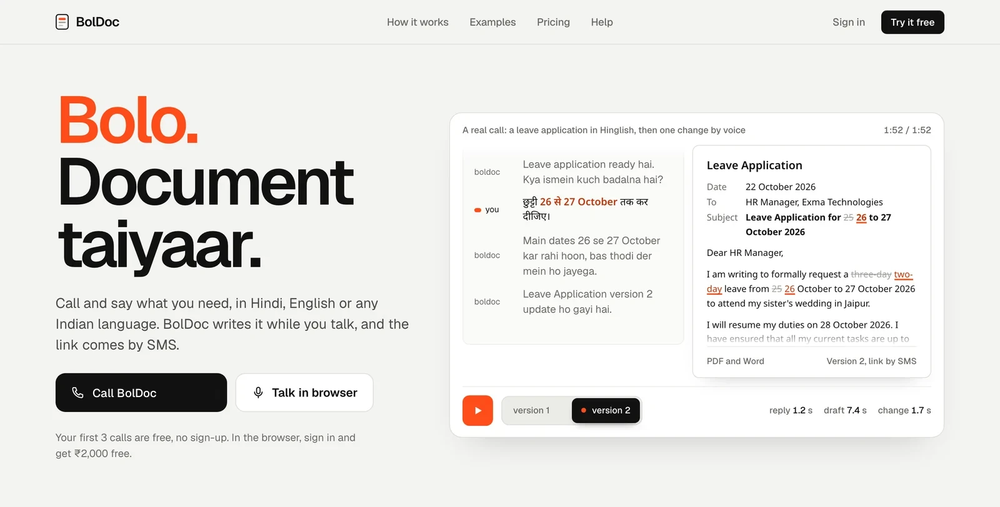
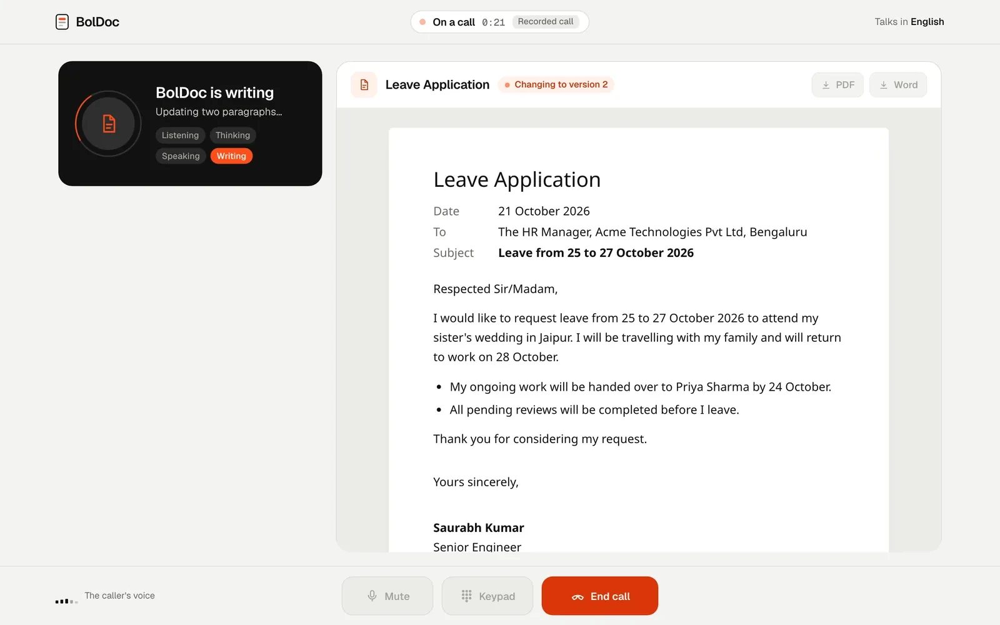
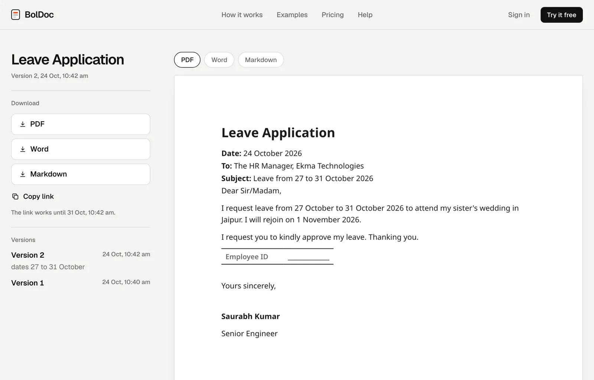
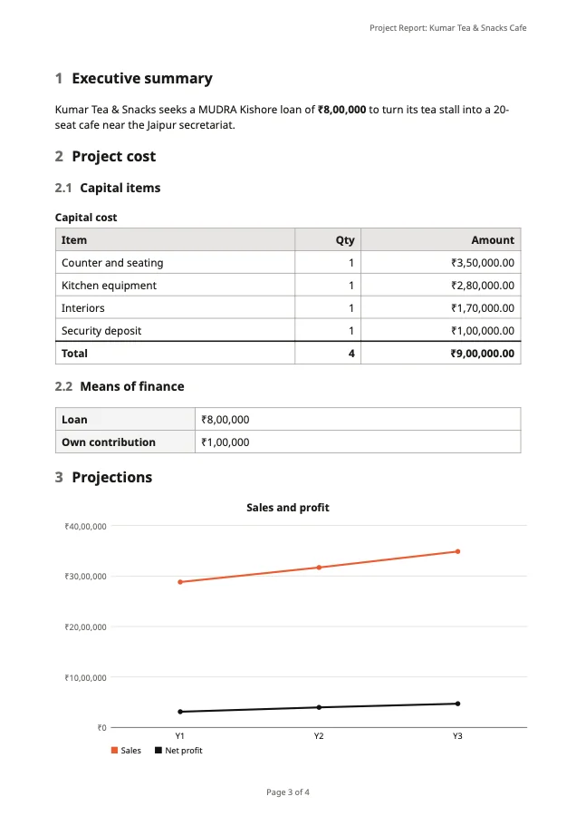
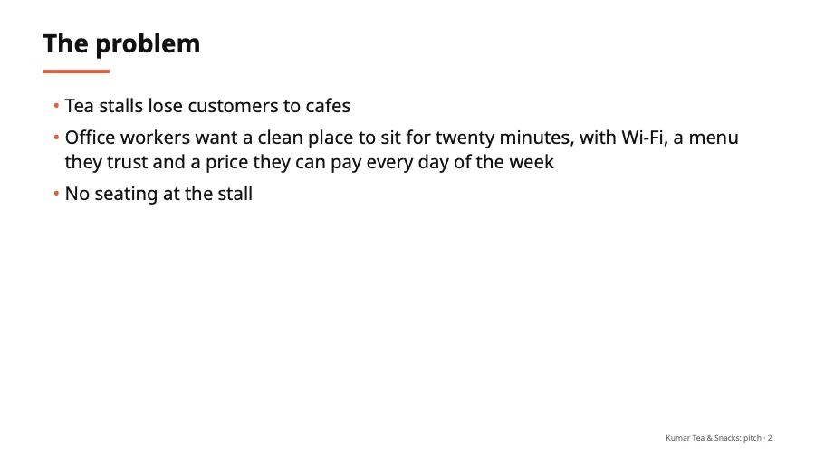
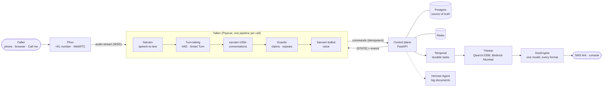
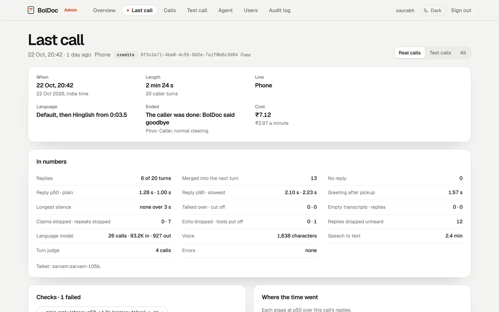
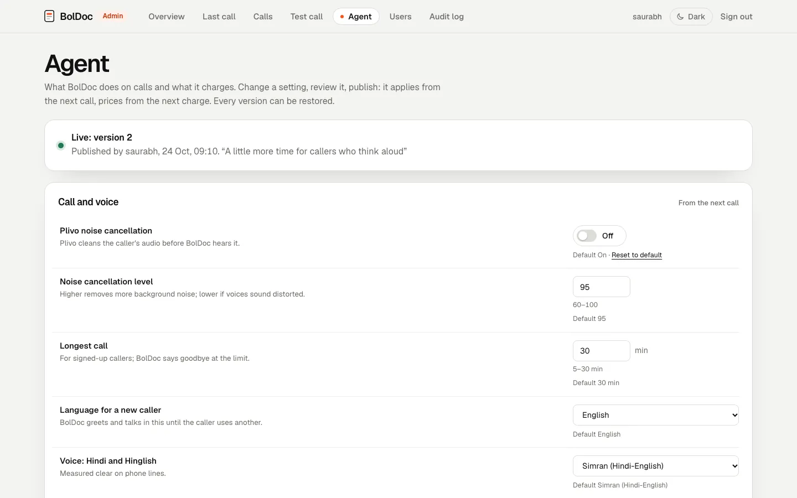

<div align="center">



# BolDoc

**Bolo. Document taiyaar.** Call, say what you need in Hindi, English or Hinglish, and BolDoc writes the document
while you talk. The link comes by SMS.

[**Try it at boldoc.in**](https://boldoc.in) &nbsp;|&nbsp;
[Architecture](#how-it-works) &nbsp;|&nbsp; [Numbers](#measured-on-real-calls) &nbsp;|&nbsp; [Decisions](#design-decisions)

[](https://github.com/saurabh-iitrke/Boldoc-Voice-Agent/actions/workflows/ci.yml)


</div>

---

A voice agent with two models. The **talker** runs the conversation in real time; the **thinker** writes and edits
the file in the background. It answers on a +91 number, in the browser over WebRTC, and rings you back on request.
Everything runs in Mumbai, so call audio and documents stay in India.

<table>
<tr>
<td width="62%"></td>
<td width="38%"></td>
</tr>
<tr>
<td><sub>A call in the browser: the document appears and changes while the conversation goes on.</sub></td>
<td><sub>Every document keeps its versions; each format downloads as rendered.</sub></td>
</tr>
</table>

## What it does

| On the call | Documents |
|---|---|
| Hindi, English and 8 more Indian languages, Hinglish included | PDF, Word, Excel, PowerPoint, CSV, Markdown and text |
| Asks for what's missing, reads it all back, writes only on a yes | Changes by voice ("26 se 27 kar do"), undo, every version kept |
| Says names back to check them; spelled names letter by letter | An earlier document changed on a later call, by its name |
| Stops the moment you talk over it; lets a slow speaker finish | Big documents (reports, decks, workbooks) written by Hermes Agent after the call |
| Never guesses: a fact nobody knows is left as a blank | Forged certificates and fake receipts are turned down |

**Around the call:** sign-in by SMS code, a console for documents and calls, credits, and an admin site with fleet
latency and cost, every call's report, test calls, and agent settings published without a deploy.

<table>
<tr>
<td width="28%"></td>
<td width="36%"></td>
<td width="36%"></td>
</tr>
<tr>
<td><sub>A project report: tables, a chart, amounts in lakh.</sub></td>
<td><sub>A pitch deck with layouts and speaker notes.</sub></td>
<td><sub>Decks and documents in Indian scripts.</sub></td>
</tr>
</table>

## How it works



- **The talker never waits for the thinker.** It sends commands and never guesses what they did: before every reply,
  control's view of the call (tasks, versions, what was said back) goes last in the model's context as `[STATE]`.
  That view is built from Postgres, never from a cache, so BolDoc never says "ready" for a file that isn't stored.
- **Turn-taking is two models plus a playback gate.** Smart Turn judges the audio; a text model judges the words; a
  reply's audio waits until the caller has really finished and is dropped, unheard, if they go on.
- **Guards in code, meaning in models.** A claim guard drops "ho gaya" until the work exists; a yes to a read-back is
  checked by the words, then by a model when the words are unclear.
- **Every change is a version.** The thinker emits checked patch operations against one document model; renderers
  turn it into each format. Nothing is overwritten, and any version can be restored.

Design notes: [turn-taking](docs/design/turns.md) · [backend](docs/design/backend.md) ·
[Hermes for big documents](docs/design/hermes.md) · [UI](docs/design/ui.md) · [LLM benchmark](docs/benchmarks/llm-models.md)

## Measured on real calls

| | Median |
|---|---|
| From answering to BolDoc's first word | **0.65 s** |
| From the caller's last word to BolDoc's reply | **1.15 s** |
| A change by voice becoming version 2 | **1.76 s** |
| Documents and changes that failed | **0 of 208** |
| Cost of a call minute (phone line, speech, voice, models, SMS) | **₹2.74**, against a ₹4 price |

<sub>Medians and costs from 21 real calls, leaving out 7 that broke (no speech reached BolDoc, a silence over 3 s, or
an empty reply). Documents and changes are counted over all calls, test calls included.</sub>

## Design decisions

| Chose | Over | Why |
|---|---|---|
| Plivo for calls, browser and SMS | Twilio, Exotel, LiveKit SIP | +91 media stays in India; one app and one stream for every way in; checkpoints and clears on the stream |
| No LiveKit server | LiveKit SFU and SIP | Plivo already ends both phone and WebRTC calls: one hop and one service fewer |
| Pipecat as plumbing | Our own media pipeline | Plivo's protocol, Sarvam's services, VAD, Smart Turn and interruptions come ready; BolDoc's logic lives in its own processors |
| Sarvam to talk | Models on Bedrock | 137 ms to the first token, best on real-call moments, the most natural Indian-language speech |
| Qwen3-235B to write | sarvam-105b | Writing on Sarvam would take from the talker's 40 requests a minute; valid document JSON first time; in Mumbai |
| Postgres, Redis and Temporal | Tasks inside the process | Durable timers, signals, retries and history; one source of truth |
| Hermes only for big documents | Hermes for everything | A letter needs two model calls and 6-12 seconds; agent loops only where planning pays |

## Repository layout

| Path | What lives there |
|---|---|
| [`apps/talker`](apps/talker) | The voice bot: Pipecat pipeline, turn-taking, playback gate, claim guard, the call session and its `[STATE]` |
| [`apps/control`](apps/control) | Control plane: Plivo webhooks and admission, accounts, the orchestrator, Temporal workflows, SMS, admin API |
| [`apps/thinker`](apps/thinker) | The writer: intake and checklists, drafter and reviewer, editor (patch ops), scoping for big documents |
| [`packages/docengine`](packages/docengine) | One document model, patch operations, renderers (PDF, Word, Excel, PowerPoint, ...) and validators |
| [`protocol`](protocol) | Commands, events and model endpoints shared by the talker, control and the thinker |
| [`web`](web) | React 19 + Vite: landing page, sign-in, console, browser calls, document pages, and the admin site |
| [`infra`](infra) | Docker Compose for one server: Caddy, talker, control, Postgres, Redis, Temporal, converter, Hermes |
| [`tests`](tests) | ~600 tests: talker logic and processors, control and accounts, workflows, documents, the scripted caller |
| [`tools`](tools) | Benchmarks behind the choices: talker and thinker models, voices, fixed audio clips |
| [`scripts`](scripts) | Deploy, the post-deploy gate (a scripted call through production), secret scan |

<table>
<tr>
<td width="50%"></td>
<td width="50%"></td>
</tr>
<tr>
<td><sub>Admin: each call's report (reply times, silences, talk-over, guards, model usage, cost). Sample data.</sub></td>
<td><sub>Admin: the agent's settings, published with a note, applied from the next call, restored in one click. Sample data.</sub></td>
</tr>
</table>

## Run it

**The web app on canned data** (no keys needed):

```bash
cd web && npm install
VITE_API_MODE=mock npm run dev        # sign-in code 246810; a recorded call plays in the browser
```

**The tests:**

```bash
python3.12 -m venv .venv && . .venv/bin/activate
pip install -r apps/control/requirements.txt -r apps/talker/requirements.txt \
            pytest hypothesis fakeredis pgserver
pytest              # control's tests start their own Postgres (pgserver); PDF tests need Pango and skip without it
cd web && npx tsc -b                   # the web app's types
```

**The whole service** needs a Plivo account (a +91 number and an app), a Sarvam API key and Amazon Bedrock access:

```bash
cd infra && cp .env.example .env       # fill in hosts and numbers; keys go in ../secrets/, never in the repo
docker compose up -d --build
```

Every deploy is followed by `scripts/e2e_gate.sh`: a scripted caller rings production, asks for a letter, changes
it, and the call's report must pass (reply latency, no dead air, no talk-over, no false "done", the document written
and changed).

---

<sub>Built by Saurabh Kumar.</sub>
